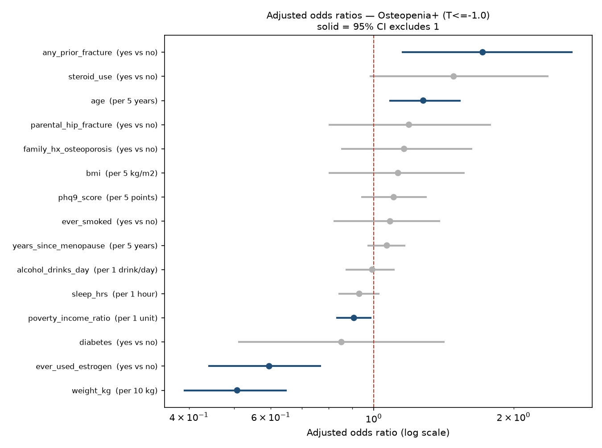
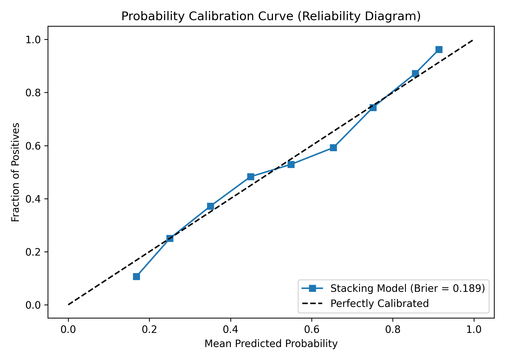

# Complete results, explained: what the model finds for osteopenia and osteoporosis

Written 2026-10-25 from the committed pipeline outputs in `outputs/` (shipped run of `OsteoporosisML.py`)
plus three exploratory runs done outside the pipeline (Section 12). Every number in Sections 1–11 comes
from a file in `outputs/`; the file name is given each time so it can be checked.

---

## The short version

1. **What we predict:** whether a woman's bone scan (DXA) would show weak bones, using only things she
   can tell her doctor or that a nurse can measure. No scan and no blood test.
2. **Two outcomes:** *osteopenia or worse* (T-score ≤ −1.0, 645 of 1,111 women) and *osteoporosis*
   (T-score ≤ −2.5, 76 of 1,111 women).
3. **How well it works:** the model ranks women correctly about **3 times in 4 for osteopenia+ (AUC
   0.747)** and about **4 times in 5 for osteoporosis (AUC 0.786)**.
4. **Compared with the free OST formula** (0.2 × (weight − age)): **a statistical tie on both
   outcomes.** OST scores 0.739 and 0.780.
5. **Why:** body weight carries almost all of the signal, and age adds a little. OST already uses both.
   The other 14 questions together add about +0.016, which isn't measurably different from zero.
6. **Nothing else we tried helped:** vitamin D, physical activity, sleep, depression score, rheumatoid
   arthritis, and later medications and weight history.
7. **The one positive signal** is exploratory and not yet in the pipeline. When all races are included
   (2,820 women), the model beats OST for osteoporosis by +0.021 [+0.008, +0.035].

---

## 1. What exactly are we predicting?

### The T-score
A DXA scan measures bone mineral density (BMD) at the hip. The **T-score** compares a woman's BMD with
the average of healthy young women:

- **T = 0:** same as a healthy 30-year-old
- **T = −1:** one standard deviation below
- **T = −2.5:** two and a half standard deviations below

This project uses the **lower of the femoral-neck and total-hip T-scores** (the WHO/ISCD rule). It uses
the NHANES III young non-Hispanic White female reference values.

### The three bone groups and the two prediction targets

| Group | T-score | Women | Share |
|---|---|---|---|
| Normal | above −1.0 | 466 | 42% |
| Low bone mass (osteopenia) | −2.5 to −1.0 | 569 | 51% |
| Osteoporosis | −2.5 or lower | 76 | 7% |
| **Total** | | **1,111** | |

The model is trained separately for two yes/no questions:

| Target | Who counts as "yes" | Yes | No |
|---|---|---|---|
| **Osteopenia+** (`at_risk`) | Low bone mass **or** osteoporosis (T ≤ −1.0) | **645 (58%)** | 466 |
| **Osteoporosis** | Osteoporosis only (T ≤ −2.5) | **76 (7%)** | 1,035 |

"Osteopenia+" means osteopenia *or worse*, so it includes the 76 women with osteoporosis. It's the
"early warning" target. Osteoporosis is the "treatment-level" target.

### Who is in the study
Women from five NHANES survey cycles (2005–06, 2007–08, 2009–10, 2013–14, 2017–20) who are:
- non-Hispanic White
- aged 50–65
- have a femoral-neck DXA result
- **postmenopausal**, meaning no period in the last 12 months

That gives 1,111 women. A duplicate-respondent check confirms nobody is counted twice.

---

## 2. How the three groups differ

From `outputs/table_one.csv`. Mean (SD) or %.

| Characteristic | Normal (466) | Low bone mass (569) | Osteoporosis (76) | What it shows |
|---|---|---|---|---|
| Age, years | 57.8 (4.5) | 58.5 (4.4) | 59.5 (3.9) | Small rise with worse bone, under 2 years in total |
| **Weight, kg** | **84.6** (17.1) | **71.8** (14.9) | **62.5** (14.4) | **The biggest difference: 22 kg between normal and osteoporosis** |
| BMI, kg/m² | 31.5 | 27.3 | 24.4 | Same story as weight |
| Years since menopause | 11.5 | 12.4 | 15.6 | Longer after menopause means worse bone |
| Ever used estrogen | 47.7% | 41.9% | 32.9% | Estrogen users have better bone |
| Ever smoked | 49.8% | 53.1% | **71.1%** | Smoking is much more common in osteoporosis |
| Any prior fracture | 12.7% | 17.0% | **27.6%** | Fractures double from normal to osteoporosis |
| Poverty income ratio | 3.4 | 3.2 | **2.2** | Lower income goes with osteoporosis |
| Diabetes | 13.1% | 8.1% | 6.6% | Diabetes goes with *higher* BMD (a known paradox; fracture risk is still higher) |
| Parental hip fracture | 13.3% | 17.3% | 18.6% | Small rise |
| Family history of osteoporosis | 26.7% | 31.6% | 36.1% | Small rise |
| Sleep, hours | 7.2 | 7.1 | 6.8 | Slightly less sleep |

**BMI groups** (from `outputs/table_one_categories.csv`):
- **58%** of the osteoporosis group are at normal weight (BMI 18.5–24.9), against 13% of the normal group.
- **Only 14%** of the osteoporosis group have BMI 30 or more, against 57% of the normal group.

**How to read this:** heavier women have stronger bones, because carrying more weight loads the
skeleton and fat tissue produces estrogen. That single fact drives most of what follows.

---

## 3. How the model was built and tested

### Inputs (16 model columns from 15 questions)
Age, weight, BMI, years since menopause, ever used estrogen, diabetes, ever smoked, alcohol (none / under
3 / 3 or more drinks a day), any prior fracture, steroid use, poverty income ratio, parental hip
fracture, family history of osteoporosis, PHQ-9 depression score, and sleep hours.

DXA and anything derived from it are blocked from the inputs.

### Eight models tried
- **Five classifiers** trained on the yes/no label: logistic regression, elastic-net logistic
  regression, random forest, LightGBM and XGBoost.
- **Three regressors** that predict the T-score number itself: Ridge, random forest and LightGBM.

### Testing method
- **5-fold cross-validation.** The women are split into 5 groups. The model learns on 4 groups and is
  tested on the 5th, and this rotates so every woman is tested once by a model that never saw her.
- **Nested cross-validation.** Picking "the best of 8" on the same data that scores it is optimistic.
  The nested version picks the model *inside* each training split, then scores it on untouched women.
  **The nested AUC is the honest number.** The leaderboard AUC is an upper bound.
- **Comparators:** OST (0.2 × (weight − age)) and weight alone.
- **The difference is tested with a bootstrap** (1,000 resamples), which gives a 95% confidence
  interval. If that interval includes 0, the model and the comparator are **not separable**.

### What AUC means
Pick one woman *with* the condition and one *without*. AUC is how often the model gives the higher risk
score to the right one. 0.50 is a coin flip and 1.00 is perfect.

---

## 4. Result 1 — Osteopenia+ (T ≤ −1.0, 645 women)

### Model leaderboard
From `outputs/model_leaderboard_osteopenia.csv`. Five-fold test AUC; sensitivity and specificity at the
default 0.5 cutoff.

| Model | Test AUC | Train AUC | Sensitivity | Specificity |
|---|---|---|---|---|
| Logistic regression (L2) | 0.752 | 0.767 | 69% | 68% |
| Elastic-net logistic regression | 0.752 | 0.767 | 69% | 68% |
| Random forest | 0.748 | 1.000 | 68% | 68% |
| LightGBM | 0.740 | 0.808 | 61% | 73% |
| XGBoost | 0.736 | 0.833 | 62% | 69% |

- **Every model lands between 0.736 and 0.752.** Simple logistic regression is at the top. The choice
  of algorithm makes almost no difference.
- The random forest's train AUC of 1.000 is normal for that method: it memorises its training data.
  The test AUC is what counts.

### The honest result

| | AUC |
|---|---|
| Leaderboard best (optimistic) | 0.752 |
| **Nested CV (honest)** | **0.747** |
| OST formula | 0.739 |
| Weight alone | 0.737 |

| Comparison | Difference | 95% CI | Verdict |
|---|---|---|---|
| Model vs OST | +0.008 | [−0.008, +0.025] | **Not separable** |
| Model vs weight alone | +0.010 | [−0.007, +0.027] | **Not separable** |

Ridge regression on the T-score was chosen in 3 of the 5 nested splits.

**What we're seeing:** the model ranks women correctly about 75% of the time. A two-number formula does
the same: the gap is less than 1 point out of 100, and the interval runs from −0.8 to +2.5 points, so
it could easily be zero. **Even weight on its own does about as well.**

---

## 5. Result 2 — Osteoporosis (T ≤ −2.5, 76 women)

### Model leaderboard
From `outputs/model_leaderboard_osteoporosis.csv`.

| Model | Test AUC | Train AUC | Sensitivity | Specificity |
|---|---|---|---|---|
| Elastic-net logistic regression | 0.793 | 0.834 | 75% | 75% |
| Logistic regression (L2) | 0.790 | 0.837 | 75% | 76% |
| Random forest | 0.785 | 1.000 | **24%** | 97% |
| LightGBM | 0.770 | 0.924 | 58% | 83% |
| XGBoost | 0.733 | 0.978 | 45% | 87% |

### The honest result

| | AUC |
|---|---|
| Leaderboard best | 0.793 |
| **Nested CV** | **0.786** |
| OST formula | 0.780 |
| Weight alone | 0.766 |

| Comparison | Difference | 95% CI | Verdict |
|---|---|---|---|
| Model vs OST | +0.007 | [−0.016, +0.030] | **Not separable** |
| Model vs weight alone | +0.021 | [−0.005, +0.048] | **Not separable** |

**What we're seeing:**
- Osteoporosis is *easier to rank* than osteopenia (about 79% vs 75%). Women with osteoporosis are
  more extreme, being lighter, older and more often smokers, so they stand out more.
- **It's still a tie with OST.**
- **This target is underpowered.** There are only 76 cases for 16 model columns, which is 4.75 events
  per predictor. The usual minimum is 10. `outputs/power_gate.csv` flagged this before the analysis
  ran. So this result is "can't tell", not "proven equal". The confidence interval is about twice as
  wide as for osteopenia+.
- **The random forest's 24% sensitivity isn't a broken model.** Only 7% of women have osteoporosis, so
  the forest's predicted probabilities rarely cross 0.5. Its AUC (0.785), which doesn't depend on a
  cutoff, is fine. A screening use would need a lower cutoff (Section 8).

---

## 6. What drives the predictions

### 6.1 Each factor's effect, adjusted for all the others
From `outputs/clinical_predictor_table.csv`, osteopenia+ target. An odds ratio (OR) below 1 means
protective, above 1 means more risk; "ns" means not significant. dAUC is how much AUC is lost when that
variable is shuffled inside the model.

| Predictor | Unit | OR (95% CI) | Effect | dAUC (logistic) |
|---|---|---|---|---|
| **Weight** | per 10 kg | **0.51 (0.39–0.65)** | **Protective** | **+0.240** |
| Poverty income ratio | per 1 unit | 0.90 (0.82–0.98) | Protective | +0.005 |
| Age | per 5 years | 1.27 (1.07–1.52) | Risk | +0.010 |
| Any prior fracture | yes vs no | 1.76 (1.20–2.74) | Risk | +0.007 |
| Ever used estrogen | yes vs no | 0.59 (0.43–0.76) | Protective | +0.009 |
| Steroid use | yes vs no | 1.49 (0.98–2.39) | ns | +0.003 |
| BMI | per 5 kg/m² | 1.12 (0.80–1.57) | ns (see note) | +0.000 |
| Years since menopause | per 5 years | 1.07 (0.97–1.17) | ns | +0.002 |
| Alcohol 3+/day | vs under 3 | 0.71 (0.43–1.07) | ns | +0.003 |
| All others (sleep, PHQ-9, smoking, diabetes, family history, parental hip fracture, no alcohol) | | CIs include 1 | ns | about 0 |

**What we're seeing:**
- **Each extra 10 kg of body weight halves the odds** of osteopenia+.
- Each 5 years of age raises the odds by 27%.
- A past fracture raises the odds by 76%.
- Ever using estrogen lowers the odds by 41%.
- Weight's importance (+0.240) is **24 times** that of the next variable (age, +0.010).
- **The BMI note:** BMI looks unimportant only because weight is already in the model and the two
  carry the same information. Take them out together and the model collapses (6.2).

### 6.2 Removing whole groups of variables
From `outputs/model_block_ablation_osteopenia.csv`. The full model scores 0.755 here.

| Test | Variables left | AUC | Loss vs full | 95% CI | Matters? |
|---|---|---|---|---|---|
| **Drop body size (BMI + weight)** | 13 | **0.603** | **0.151** | [+0.115, +0.187] | **Yes, hugely** |
| Drop all menopause/hormone variables | 13 | 0.749 | 0.006 | [−0.000, +0.013] | No |
| Drop all lifestyle variables | 13 | 0.756 | −0.001 | [−0.004, +0.003] | No |
| Drop all history/family variables | 11 | 0.751 | 0.004 | [−0.003, +0.011] | No |
| **Keep only age + weight (OST's inputs)** | **2** | **0.739** | 0.016 | [−0.000, +0.031] | **No: 2 variables do nearly the full job** |
| Keep only age + BMI | 2 | 0.718 | 0.037 | [+0.016, +0.057] | Yes (BMI is a worse substitute for weight) |

**What we're seeing:** without body size the model drops to 0.603, close to guessing. Remove any other
group *entirely* and nothing measurable happens. **Age and weight alone reproduce OST's 0.739 to three
decimals.** The other 14 columns add +0.016, and that interval touches zero.

### 6.3 Removing one variable at a time
From `outputs/model_variable_ablation_osteopenia.csv`. After correcting for testing 15 variables (Holm
correction), **only weight is significant on its own** (loss +0.018 [+0.007, +0.030]). Estrogen use is
next (+0.006, uncorrected p = 0.022, but not significant after correction). Everything else is within
noise.

---

## 7. Are the predicted risks believable? (Calibration)

- The dashed diagonal is perfect: "predicted 60%" would mean 60% actually have it.
- Both forest curves follow the diagonal fairly closely, with some wobble.
- The Brier score (average squared error of the risk, lower is better) is **0.200 calibrated** and
  0.201 raw. For comparison, always guessing 58% would score about 0.24.

**What we're seeing:** when the model says "70% risk", roughly 70% of those women really do have
osteopenia+. The probabilities can be used to set a referral cutoff.

---

## 8. What it would mean in a clinic

### 8.1 Scan the top-ranked women
From `outputs/referral_table.csv`, osteopenia+, using the nested CV ranks.

| Rule | Scans ordered | Cases found (of 645) | Missed | Share of scans that find a case |
|---|---|---|---|---|
| Scan everyone | 1,111 | 645 (100%) | 0 | 58% |
| Scan top 50% | 556 | 415 (64%) | 230 | 75% |
| Scan top 40% | 446 | 348 (54%) | 297 | 78% |
| Scan top 30% | 335 | 281 (44%) | 364 | 84% |
| Scan top 25% | 280 | 243 (38%) | 402 | 87% |

### 8.2 Scan everyone above a risk cutoff
From `outputs/threshold_sweep.csv`, using the calibrated forest (AUC 0.749).

| Cutoff | Scans ordered | Cases found | Missed | Scans saved vs scanning all |
|---|---|---|---|---|
| 50% | 692 | 482 (75%) | 163 | 419 |
| 40% | 895 | 579 (90%) | 66 | 216 |
| 35% | 965 | 603 (93%) | 42 | 146 |
| 30% | 1,030 | 631 (98%) | 14 | 81 |
| Scan all | 1,111 | 645 (100%) | 0 | 0 |

**What we're seeing:**
- Scanning the top half finds **415** cases. A random half would find about **323**, so the score
  finds about 90 more for the same number of scans.
- A **40% cutoff** catches 90% of cases while skipping 216 scans (about 19%).
- **Because the model ties OST, OST would give very nearly the same savings for free.** These tables
  show what *any* weight-and-age score can do.

---

## 9. Extra variables tested (pre-specified arms)

From `outputs/prespecified_arms.csv`, osteopenia+. Each arm was refit on the same women with and without
the new variable.

| Arm | Variable(s) added | Women | Gain in AUC | 95% CI | Verdict |
|---|---|---|---|---|---|
| C | Vitamin D + calcium intake | 930 | −0.002 | [−0.006, +0.001] | No gain |
| D | Blood vitamin D (25(OH)D) | 974 | −0.001 | [−0.008, +0.005] | No gain |
| E | Rheumatoid arthritis | 988 | 0.000 | [−0.001, +0.001] | No gain |
| F | Depression (PHQ-9 ≥ 10) | 1,110 | −0.001 | [−0.002, +0.000] | No gain |
| I | Physical activity (MET-minutes + sitting) | 932 | +0.004 | [−0.002, +0.009] | No gain |
| I2 | Moderate + vigorous minutes + sitting | 932 | +0.003 | [−0.002, +0.009] | No gain |
| J | Sleep in five bands | 1,107 | −0.001 | [−0.007, +0.006] | No gain |

**What we're seeing:** every arm lands within ±0.004 of zero. Nutrition, blood vitamin D, activity,
sleep, mood and arthritis add nothing once weight and age are known. These tests were written down
before running, so the null results count as real findings.

### Sensitivity checks (do the choices matter?)
- **Diabetes coding** (G1: borderline counted as diabetic; G2: diabetes dropped): AUC stays at 0.755.
- **Bone site** (H1: femoral neck only, 618 cases, AUC 0.747; H2: total hip only, 424 cases, AUC
  0.776). Different outcomes, so these aren't subtracted from the headline. The model works at both
  sites.

---

## 10. Robustness checks

### 3-fold instead of 5-fold cross-validation
Exploratory run, 2026-10-25, with no code changed.

| Target | 5-fold nested AUC | 3-fold nested AUC | Δ vs OST, 3-fold | Verdict |
|---|---|---|---|---|
| Osteopenia+ | 0.747 | 0.752 | +0.014 [−0.003, +0.029] | Not separable (same) |
| Osteoporosis | 0.786 | 0.790 | +0.011 [−0.013, +0.034] | Not separable (same) |

### Random forest leaf size
From `outputs/rf_leaf_tuning.csv`. Test AUC varies only from 0.745 to 0.752 across leaf sizes 1–50, so
tuning doesn't change the conclusion.

---

## 11. The data leak we found and fixed

From `outputs/auc_decomposition.csv`. NHANES re-released 2017–2018 inside the 2017–2020 files under new
ID numbers, so **176 women were counted twice**. Copies of the same woman sat in both the training and
test groups, and the model "recognised" them.

| Stage | Women | Best AUC | OST | Gain over OST | Beats OST? |
|---|---|---|---|---|---|
| A. With duplicates, all DXA women | 1,484 | 0.836 | 0.747 | +0.089 | Yes (false) |
| B. With duplicates, postmenopausal | 1,272 | 0.831 | 0.733 | +0.098 | Yes (false) |
| C. Duplicates removed, all DXA women | 1,308 | 0.763 | 0.753 | +0.010 | No |
| **D. Duplicates removed, postmenopausal (final)** | **1,111** | **0.755** | **0.739** | **+0.016** | **No** |

**What we're seeing:** removing duplicates alone dropped the AUC by **0.073** (A → C), and the "beats
OST" result disappeared. Restricting to postmenopausal women cost almost nothing (−0.005, A → B). All
pre-fix AUCs (0.810, 0.806, 0.833) are withdrawn.

---

## 12. Exploratory results (outside the pipeline — not yet presentable)

These came from scratch scripts that import the pipeline without changing it. **They need to be added to
`OsteoporosisML.py` properly before being presented.**

### 12.1 All races included (2,820 postmenopausal women aged 50–65)
1,453 with osteopenia+ and 156 with osteoporosis.

| Target | Model (nested) | OST | Δ vs OST [95% CI] | Verdict |
|---|---|---|---|---|
| Osteopenia+ | 0.757 | 0.751 | +0.007 [−0.001, +0.014] | Not separable |
| **Osteoporosis** | **0.822** | **0.800** | **+0.021 [+0.008, +0.035]** | **Beats OST** |

The 3-fold version gives the same verdicts: osteoporosis +0.022 [+0.007, +0.038].

**OST AUC by race:**

| Race | Women | OST, osteopenia+ | OST, osteoporosis (cases) |
|---|---|---|---|
| Non-Hispanic White | 1,111 | 0.739 | 0.780 (76) |
| Non-Hispanic Black | 660 | 0.768 | 0.924 (18) |
| Mexican American | 441 | 0.692 | 0.797 (16) |
| Other Hispanic | 315 | 0.744 | 0.746 (17) |
| Other / multi-racial | 293 | 0.738 | 0.705 (29) |

**What we're seeing:**
- For osteopenia+, more women doesn't help. It's still a tie.
- For osteoporosis, doubling the cases (76 → 156) let the model pull ahead by a small but real 2 points.
- OST works similarly across races for osteopenia+ (0.69–0.77). Each group's osteoporosis numbers rest
  on too few cases to compare.

### 12.2 Medications and weight history (24 pre-specified tests)
Medication arm: 8 drug classes (PPIs, antidepressants, thiazides, loop diuretics, thyroid hormone,
anticonvulsants, aromatase inhibitors, TZDs). Weight-history arm: weight change since age 25, distance
below heaviest weight, change over the past year. Height-loss arm: reported height minus measured
height. Each was tested on three cohorts (White, all races, all races excluding women already on
osteoporosis drugs).

- **Only one test cleared zero:** medications, osteoporosis, all races, +0.008 [+0.000, +0.016].
  It **lost significance** after excluding the 119 women already on osteoporosis drugs (+0.006
  [−0.002, +0.016]).
- Weight history and height loss added nothing (about ±0.001).
- With 24 tests, about 1 false positive is expected by chance.

---

## 13. Bottom line

| Question | Answer |
|---|---|
| Can a questionnaire model spot weak bones? | **Yes.** It ranks correctly about 75% of the time for osteopenia+ and 79% for osteoporosis |
| Is it better than the free OST formula? | **No, it's a statistical tie** for both outcomes in the main cohort |
| Why? | **Body weight carries the signal** and age adds a little. OST uses exactly those two |
| Does the algorithm matter? | No. All 8 score within a few hundredths, and simple regression is at the top |
| Do extra questions help? | No: 7 pre-specified arms plus 24 medication and weight-history tests show nothing reliable |
| Any exception? | Osteoporosis in the all-race cohort, a small real gain of +0.021 (exploratory) |
| Clinical message | **For primary care, OST is near the limit of what questionnaire data can do. Use it.** |

### Limitations to state up front
- The osteoporosis target is **underpowered**: 4.75 events per predictor against a minimum of 10.
- **No external validation yet.** All results are cross-validated within NHANES.
- NHANES **survey weights are not applied**, so results describe this sample, not the US population.
- T-scores use a **White reference** for every woman (the ISCD convention).
- Cross-sectional data. The model detects low BMD today; it doesn't predict future fractures.

---

## Glossary

- **AUC:** the chance the model ranks a random case above a random non-case. 0.5 is chance, 1.0 is
  perfect.
- **Nested cross-validation:** testing that keeps model selection away from the test data. Gives the
  honest AUC.
- **95% CI:** the range the true value plausibly lies in. If a difference's CI includes 0, the two
  methods are "not separable".
- **Odds ratio (OR):** above 1 raises risk, below 1 lowers it. 0.51 per 10 kg means the odds halve for
  every extra 10 kg.
- **Sensitivity:** the share of real cases the model flags.
- **Specificity:** the share of non-cases the model correctly clears.
- **Calibration / Brier score:** whether a predicted "70%" really means 70%. Brier is lower for better
  probabilities.
- **Events per predictor (EPP):** cases divided by model inputs. Below 10 means the estimates are
  unstable.
- **OST:** Osteoporosis Self-assessment Tool, 0.2 × (weight in kg − age in years). Lower means higher
  risk.
