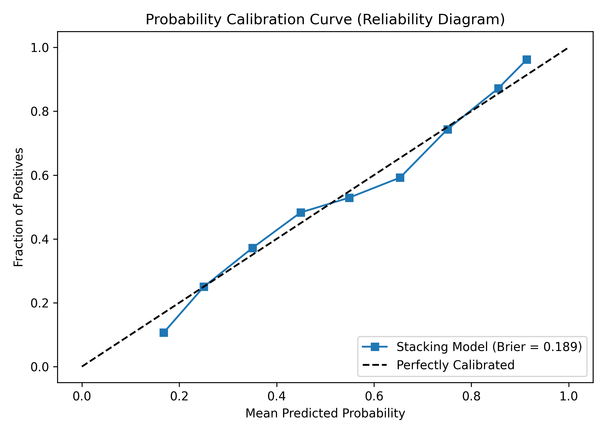
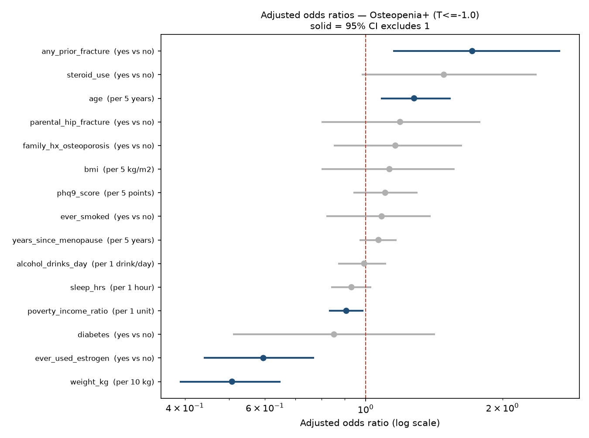

# Machine-Learning Identification of Low Bone Mineral Density from Primary-Care-Available Information in Postmenopausal Women Aged 50–65: A Cross-Sectional NHANES Study

**Draft** · Prepared 31 October 2026 · Author: [student name] · Clinical adviser: [specialist name]

*Every figure in Sections 3.1–3.5 comes from the committed run of `OsteoporosisML.py` (files in
`outputs/`). Section 5 describes planned work. Results in Section 5 that come from exploratory runs
are labelled as exploratory.*

> **Note on framing (remove before circulation).** This version presents the model as a detection
> tool, in the style of Wu et al. 2023, Xu et al. 2024, Tang et al. 2026 and Wang J et al. 2026. The
> OST result is kept as **one benchmark sentence** in the Results and one paragraph in the Discussion,
> not as the research question. Don't delete it completely: reviewers in this field (Smets et al.,
> JBMR 2021) expect a new tool to be compared with existing ones, and the specialist has already seen
> the OST result.

---

## Abstract

**Background.** Osteoporosis is often undiagnosed in women younger than 65, because routine DXA
screening starts at 65. The 2025 USPSTF recommendation asks clinicians to identify at-risk younger
postmenopausal women before referring them for DXA, but primary care has few simple tools for this.
This study aimed to develop and internally validate a machine-learning model that identifies
osteopenia and osteoporosis using only information available at a primary-care visit, with no
imaging or laboratory tests.

**Methods.** We analysed non-Hispanic White postmenopausal women aged 50–65 with hip DXA from five
NHANES cycles (2005–2020; n = 1,111). Outcomes were the lower of the femoral-neck and total-hip
T-scores: ≤ −1.0 (osteopenia or worse) and ≤ −2.5 (osteoporosis). Fifteen predictors were selected
with an osteoporosis specialist: demographics, measured body size, reproductive history, medical and
family history, lifestyle, mood and sleep. Eight algorithms were compared. Performance was estimated
by nested 5-fold cross-validation, together with calibration and DXA referral analyses. A
duplicate-respondent audit was built into the pipeline.

**Results.** Of the 1,111 women, 645 (58.1%) had osteopenia or worse and 76 (6.8%) had osteoporosis.
- **Osteopenia or worse:** nested-CV AUC **0.747**.
- **Osteoporosis:** nested-CV AUC **0.786**.
- Logistic regression performed as well as the tree-based and boosted models.
- Predicted risks were well calibrated: Brier score 0.200, against 0.24 for a constant prediction.
- At a 40% risk threshold, the model identified 89.8% of women with osteopenia or worse while
  avoiding 19% of DXA scans.
- Lower body weight was the dominant predictor (adjusted OR 0.51 per 10 kg). Older age, prior
  fracture, never having used estrogen, and lower income were also independently associated.
- Performance was comparable to the USPSTF-cited Osteoporosis Self-Assessment Tool (OST).

**Conclusions.** A model built only on information available at a primary-care visit identified
postmenopausal women aged 50–65 with low bone density with acceptable discrimination and good
calibration. Body weight and age carried most of the signal. The model could support DXA referral
decisions in younger postmenopausal women, but external and temporal validation are needed first.

**Keywords:** osteoporosis; osteopenia; machine learning; screening; postmenopausal women; NHANES;
primary care; bone mineral density

---

## 1. Introduction

Osteoporosis is a common skeletal disease of low bone mass and deteriorated bone structure. It raises
fracture risk and is often silent until the first fracture. In the United States, most screening
guidance starts routine DXA at age 65. Women aged 50–64 are screened only if they're judged to be at
increased risk, so many women with low bone density in this age group are never identified.

The 2025 USPSTF recommendation advises clinicians to use a clinical risk assessment before DXA in
postmenopausal women younger than 65. Existing tools discriminate only moderately in this age group.
In the Women's Health Initiative Bone Density Substudy of women aged 50–64, AUCs for osteoporosis at
any site were 0.63–0.66 (Zheng et al., 2025). Primary care needs a way of identifying these women
from information it already collects.

Machine learning (ML) has been used increasingly to predict low bone density from clinical data.
Reported AUCs vary widely, from about 0.65 to above 0.95. Much of that variation comes from study
design:
- including men or a wide age range
- adding laboratory or imaging inputs
- defining the outcome by self-reported diagnosis rather than DXA
- validating on a single random split

Among clinical-predictor models in postmenopausal women, a 2026 systematic review found a pooled AUC
of about 0.77. ML and regression performed similarly (0.74 and 0.75).

This study aimed to develop and internally validate an ML model that identifies **osteopenia** and
**osteoporosis** in postmenopausal women aged 50–65 using only information available at a primary-care
visit. We also aimed to:
- identify which factors drive the predictions
- check whether predicted risks are calibrated
- translate performance into DXA referral numbers a clinic could use

---

## 2. Methods

### 2.1 Data source and study design
This is a cross-sectional analysis of the National Health and Nutrition Examination Survey (NHANES).
NHANES is a nationally representative US survey that combines interviews, a physical examination and,
in selected cycles, hip DXA. We used the five cycles with femoral-neck DXA: 2005–2006, 2007–2008,
2009–2010, 2013–2014 and 2017–March 2020. The study follows the TRIPOD+AI reporting guideline (Collins
et al., 2024).

NHANES pooled the complete 2017–2018 sample into the 2017–March 2020 files under new respondent IDs.
So the separate 2017–2018 release was not used, to avoid counting the same women twice (Section 2.7).

### 2.2 Participants

| Step | Remaining |
|---|---|
| NHANES respondents, five cycles | 56,769 |
| Female | 28,644 |
| Non-Hispanic White | 10,672 |
| Aged 50–65 | 1,639 |
| Femoral-neck DXA available | 1,308 |
| Excluded: menstrual period in the past 12 months | −156 |
| Excluded: menopausal status unknown | −41 |
| **Analysis cohort** | **1,111** |

Postmenopausal status was defined as no menstrual period in the past 12 months.

### 2.3 Outcomes
T-scores were calculated against the NHANES III young non-Hispanic White female reference (Looker et
al., 1998). Following the WHO/ISCD convention, the lower of the femoral-neck and total-hip T-scores
defined each woman's status. There were two binary outcomes:
- **Osteopenia or worse:** T ≤ −1.0. Primary outcome; the "early identification" target.
- **Osteoporosis:** T ≤ −2.5. Secondary outcome; the treatment-level target.

### 2.4 Predictors
Predictors were limited to information a primary-care clinician can collect by asking the patient or
measuring at the visit. Imaging and laboratory results were excluded. The list was agreed with an
osteoporosis specialist before modelling.

| Domain | Predictors |
|---|---|
| Demographic | Age; poverty income ratio |
| Body size (measured) | Weight; BMI |
| Reproductive | Years since menopause; ever used estrogen |
| Medical history | Diabetes; any prior fracture; oral steroid use |
| Family history | Parental hip fracture; family history of osteoporosis |
| Lifestyle | Ever smoked; alcohol (none / < 3 / ≥ 3 drinks per day) |
| Mood and sleep | PHQ-9 depression score; sleep hours |

That gives 15 predictors and 16 model columns. "Refused" and "don't know" answers were set to missing.
Missing values were filled with the median, learned within each training fold only. No predictor was
missing for more than 13.6% of women. DXA-derived variables were blocked from every model by a fixed
allow-list and an automatic check.

### 2.5 Model development
Eight algorithms were trained:
- **Five classifiers on the binary outcome:** logistic regression (L2), elastic-net logistic
  regression, random forest, LightGBM and XGBoost.
- **Three regressors on the continuous T-score:** ridge regression, random forest and LightGBM. Their
  predicted T-score was used as the risk score.

The boosted models were constrained to depth 2 to limit overfitting. Class imbalance was handled with
balanced class weights.

### 2.6 Model validation and evaluation
- **Discrimination:** AUC under **nested 5-fold cross-validation**. In each outer fold, the algorithm
  was chosen by an inner 3-fold cross-validation on the training data only, then scored on the
  held-out fold. The nested AUC is the primary estimate. It isn't inflated by picking the best of
  eight models.
- **Calibration:** a reliability curve and Brier score for a sigmoid-calibrated random forest,
  computed on out-of-fold predictions.
- **Clinical utility:** sensitivity, PPV, cases missed and DXA scans avoided across a range of risk
  thresholds.
- **Interpretation:**
  - adjusted odds ratios with bootstrap 95% CIs
  - permutation importance
  - refitting without single predictors (Holm-corrected) and without whole predictor groups
- **Pre-specified extensions:** seven additional predictor sets were written down before testing. Each
  was compared with a base model refitted on the same women:
  - dietary and supplement vitamin D and calcium
  - serum 25(OH)D
  - rheumatoid arthritis
  - depression (PHQ-9 ≥ 10)
  - two physical-activity measures
  - sleep in five categories
- **Sample size:** events per predictor were checked against a minimum of 10 (Riley et al., 2020).
- **Reproducibility:** fixed random seed. The full pipeline reproduces exactly from public data.

### 2.7 Data-integrity audit
In an earlier version of the analysis, 176 women appeared twice under different respondent IDs,
because of the overlapping 2017–2018 and 2017–March 2020 releases. Duplicates were removed. The
pipeline now checks a physical fingerprint (both BMD values, weight, height and age) and stops if any
two records match. Results before this correction are not reported.

---

## 3. Results

### 3.1 Participant characteristics
Mean age was 58.3 years. 466 women (41.9%) had normal BMD, 569 (51.2%) had low bone mass and 76
(6.8%) had osteoporosis.

**Table 1. Characteristics by bone status** (mean (SD) or %)

| Characteristic | Normal (n = 466) | Low bone mass (n = 569) | Osteoporosis (n = 76) |
|---|---|---|---|
| Age, years | 57.8 (4.5) | 58.5 (4.4) | 59.5 (3.9) |
| Weight, kg | 84.6 (17.1) | 71.8 (14.9) | 62.5 (14.4) |
| BMI, kg/m² | 31.5 (6.3) | 27.3 (5.6) | 24.4 (5.4) |
| Years since menopause | 11.5 (8.9) | 12.4 (8.4) | 15.6 (9.7) |
| Ever used estrogen | 47.7% | 41.9% | 32.9% |
| Ever smoked | 49.8% | 53.1% | 71.1% |
| Any prior fracture | 12.7% | 17.0% | 27.6% |
| Poverty income ratio | 3.4 (1.7) | 3.2 (1.7) | 2.2 (1.6) |
| Family history of osteoporosis | 26.7% | 31.6% | 36.1% |
| Diabetes | 13.1% | 8.1% | 6.6% |

Women with osteoporosis were on average 22 kg lighter than women with normal BMD. They had been
postmenopausal for longer, smoked more, had more prior fractures and had lower income.

### 3.2 Model performance

**Table 2. Discrimination by outcome**

| | Osteopenia or worse | Osteoporosis |
|---|---|---|
| Cases / total | 645 / 1,111 (58.1%) | 76 / 1,111 (6.8%) |
| AUC range across 8 algorithms (5-fold CV) | 0.736–0.752 | 0.733–0.793 |
| Best single algorithm | Logistic regression, 0.752 | Elastic-net logistic regression, 0.793 |
| **Nested CV AUC (primary)** | **0.747** | **0.786** |
| Sensitivity / specificity, best algorithm (0.5 cut-off) | 69% / 68% | 75% / 75% |

- Discrimination was acceptable for both outcomes and slightly higher for osteoporosis.
- Logistic regression and elastic-net regression were at or near the top. Random forest, LightGBM and
  XGBoost didn't improve on them.
- The leaderboard and nested AUCs differed by only 0.005–0.007, so the model selection step added
  little optimism.
- For reference, OST, 0.2 × (weight − age), scored 0.739 and 0.780 in the same women. The model's
  performance was comparable to this guideline-cited tool.

### 3.3 Calibration
Out-of-fold predicted risks followed observed rates closely (Figure 1). The Brier score was 0.200
after calibration (0.201 before), against about 0.24 for a constant prediction.

### 3.4 Clinical utility

**Table 3. DXA referral at different predicted-risk thresholds** (osteopenia or worse; 1,111 women, 645
cases)

| Refer if risk ≥ | DXAs ordered | Cases found (sensitivity) | Cases missed | PPV | DXAs avoided vs scanning all |
|---|---|---|---|---|---|
| 50% | 692 | 482 (74.7%) | 163 | 69.7% | 419 (38%) |
| 40% | 895 | 579 (89.8%) | 66 | 64.7% | 216 (19%) |
| 35% | 965 | 603 (93.5%) | 42 | 62.5% | 146 (13%) |
| 30% | 1,030 | 631 (97.8%) | 14 | 61.3% | 81 (7%) |
| Scan all | 1,111 | 645 (100%) | 0 | 58.1% | 0 |

- A 40% threshold would identify about 9 in 10 women with osteopenia or worse while avoiding about 1
  in 5 scans.
- Ranking women by the model and scanning the top half would find 415 cases, against about 323 for a
  random half.

### 3.5 Predictors of low bone density

**Table 4. Adjusted odds ratios, osteopenia or worse** (logistic regression with all predictors)

| Predictor | Unit | OR (95% CI) |
|---|---|---|
| **Weight** | per 10 kg | **0.51 (0.39–0.65)** |
| **Age** | per 5 years | **1.27 (1.07–1.52)** |
| **Any prior fracture** | yes vs no | **1.76 (1.20–2.74)** |
| **Ever used estrogen** | yes vs no | **0.59 (0.43–0.76)** |
| **Poverty income ratio** | per 1 unit | **0.90 (0.82–0.98)** |
| Oral steroid use | yes vs no | 1.49 (0.98–2.39) |
| Parental hip fracture | yes vs no | 1.18 (0.80–1.77) |
| Family history of osteoporosis | yes vs no | 1.16 (0.85–1.62) |
| Years since menopause | per 5 years | 1.07 (0.97–1.17) |
| Ever smoked | yes vs no | 1.08 (0.82–1.39) |

Bold: 95% CI excludes 1. BMI has no independent effect once weight is in the model, because the two
are closely correlated.

- **Body weight was the dominant predictor.** Each additional 10 kg halved the odds of osteopenia or
  worse.
- Removing weight and BMI together lowered the AUC from 0.755 to 0.603 (loss 0.151, 95% CI
  0.115–0.187).
- A model with age and weight alone reached 0.739. The other 13 predictors added +0.016 (95% CI
  −0.000 to +0.031).
- Removing the menopause and hormone, lifestyle, or history and family predictor groups had no
  measurable effect.
- **None of the seven pre-specified additions improved discrimination.** All changes were within
  ±0.004 AUC: dietary or supplement vitamin D and calcium, serum 25(OH)D, rheumatoid arthritis,
  depression, physical activity and sleep.

**Sensitivity analyses:**
- Recoding diabetes didn't change the AUC (0.755).
- The model performed similarly with single-site outcomes: femoral neck 0.747, total hip 0.776.
- 3-fold instead of 5-fold nested CV gave 0.752 and 0.790.
- Random-forest leaf size (1–50) changed the AUC by less than 0.01.

---

## 4. Discussion

### 4.1 Principal findings
Using information available at a primary-care visit, the model identified postmenopausal women aged
50–65 with osteopenia or worse (AUC 0.747) and osteoporosis (AUC 0.786). Discrimination was
acceptable, and predicted risks were well calibrated. A 40% risk threshold would capture about 90% of
women with osteopenia or worse while avoiding about one in five DXA scans.

Body weight was by far the strongest predictor, followed by age. Prior fracture, estrogen use and
income were also independently associated with low bone density, in the expected directions. Simple
logistic regression performed as well as the more complex algorithms.

### 4.2 Comparison with previous studies
- **The performance matches comparable studies.** An independent NHANES analysis of postmenopausal
  women reported AUCs of 0.764 for a Bayesian network and 0.752 for logistic regression (Wu et al.,
  2023). In Korean postmenopausal women, survey-based models with 5-fold CV reached 0.65–0.74 (Shim et
  al., 2020). A 2026 systematic review of 21 postmenopausal models reported a pooled AUC of 0.77, with
  ML and regression similar (0.74 and 0.75).
- **External validation typically lowers AUCs into this range.** An NHANES model of women aged 60 and
  over fell from 0.80 internally to 0.74 in a Chinese cohort (Tang et al., 2026). A nationwide Chinese
  screening model scored 0.750 and 0.744 in two external cohorts.
- **Regression performed as well as ML**, as found by Xu et al. (2024) in NHANES and by Christodoulou
  et al. (2019) across 71 studies. This favours a transparent model that can be written as an equation
  or nomogram.
- **Comparison with OST.** OST is calculated from weight and age, and those two inputs carried most of
  the signal here. The model's AUC was therefore close to OST's in the same women (0.747 vs 0.739;
  0.786 vs 0.780), and the differences weren't statistically detectable. The model's added value is in
  what OST doesn't provide:
  - a calibrated individual probability rather than a score
  - explicit referral thresholds
  - a framework that can take new predictors as they're validated
- **Why our AUCs are lower than some studies.** Studies reporting AUCs above 0.85 typically pool men
  and women, include older adults, use laboratory or imaging inputs, or define the outcome by
  self-reported diagnosis. This study used none of those, and we also audited for duplicate
  respondents. Without that audit, the AUC in our data was inflated by 0.07.

### 4.3 Clinical implications
In primary care, a woman's weight, age and a short history are enough to estimate her probability of
low bone density before deciding on DXA. The model's calibrated risk lets a clinic choose a threshold
that suits its resources: a lower threshold for high sensitivity, or a higher one to save scans. The
results also suggest that adding nutrition, activity, sleep or mood questions to the clinic visit
won't improve selection for DXA.

### 4.4 Strengths
- The outcome was DXA-measured BMD, not self-reported diagnosis.
- The population was restricted to the age group where screening decisions are hardest.
- Nested cross-validation kept model selection separate from evaluation.
- Calibration and referral analyses were reported alongside discrimination.
- Additional predictor sets were pre-specified, so null results are interpretable.
- A built-in duplicate-respondent audit.
- The predictor list was agreed with a specialist.
- The pipeline is fully reproducible from public data.

### 4.5 Limitations
1. **No external or temporal validation.** All estimates come from cross-validation within NHANES.
2. **Osteoporosis is underpowered:** 76 cases, 4.75 events per predictor against a recommended 10. The
   osteoporosis AUC is less precise than the osteopenia AUC.
3. **Single population:** non-Hispanic White women aged 50–65. The model can't yet be applied to other
   groups.
4. **NHANES survey weights were not applied.** Results describe this sample, not the US population.
5. **Cross-sectional design:** the model identifies current low BMD, not future fracture.
6. **Hip sites only;** the lumbar spine wasn't available in all cycles.
7. **Some predictors are self-reported** (prior fracture, steroid use, menopause timing) and may be
   misclassified. Falls history wasn't available.
8. **NHANES predictors are survey answers,** not primary-care records. Answers in a real clinic may
   differ.

---

## 5. Future work

The next phase would move the model from internal validation towards a tool that could be tested in
practice.

### 5.1 Validation
- **Temporal validation.** Train on 2005–2014 and test on the held-out 2017–March 2020 cycle, following
  Xu et al. (2024). This is the most direct test of whether the model holds up over time.
- **External validation** in a clinical cohort with DXA, such as a health-system primary-care
  population, the Women's Health Initiative, or KNHANES. Expect a drop of about 0.03–0.06 in AUC.
- **Survey-weighted estimates** for a contiguous cycle set, so results can describe US women aged 50–65.

### 5.2 Wider population
- **Include all races and ethnicities.** An exploratory run on 2,820 women of all races gave a nested
  AUC of **0.757 for osteopenia or worse** and **0.822 for osteoporosis**, with 156 osteoporosis cases,
  twice the main cohort's number. This analysis needs to be built into the main pipeline with its own
  checks before it can be reported. *(Exploratory, not yet in the pipeline.)*
- **Report performance and calibration separately for each race and ethnicity**, and test
  race-specific T-score references as a sensitivity analysis.
- **Extend the age range** to 50–79 to cover the full screening population.

### 5.3 Better evaluation
- **Decision curve analysis** to show net benefit across thresholds.
- **Calibration slope and intercept**, not just the curve.
- **SHAP plots** for overall and individual explanation.
- **A rule-out analysis** reporting NPV at a high-sensitivity threshold ("who can safely skip a
  scan"), as in the 2026 Chinese nationwide model.
- **Formal equivalence testing** against existing tools (OST, ORAI, OSIRIS, FRAX without BMD), using
  a margin agreed in advance with the specialist.

### 5.4 New predictors
- **Height loss** measured against a recorded earlier height, which was a strong item in the Hong Kong
  POST tool.
- **Falls history,** kyphosis, early or surgical menopause, and number of teeth lost.
- **Medication classes known to affect bone:** proton-pump inhibitors, aromatase inhibitors, thyroid
  hormone and anticonvulsants. An exploratory test of eight classes found no reliable gain in the
  current data. *(Exploratory.)*
- **Routine primary-care labs** (creatinine, ALP, HbA1c) as an optional second tier for women who
  already have recent results.

### 5.5 Towards a usable tool
- **A nomogram or point score** derived from the logistic model for paper use.
- **A web calculator with public code,** following the 2026 *BioData Mining* example.
- **Fracture outcomes,** in a cohort with follow-up, to test whether women the model flags go on to
  fracture more often.
- **A pilot in a primary-care clinic,** comparing referral numbers and DXA yield with usual care.

---

## 6. Conclusions
A machine-learning model using only information available at a primary-care visit identified
postmenopausal women aged 50–65 with osteopenia or osteoporosis with acceptable discrimination and
good calibration. Body weight and age carried most of the predictive signal, and logistic regression
was sufficient. With temporal and external validation, the model could help primary-care clinicians
decide which younger postmenopausal women to refer for DXA.

---

## References
1. US Preventive Services Task Force. Screening for osteoporosis to prevent fractures:
   recommendation statement. 2025.
2. Zheng HW, Crandall CJ, et al. Identifying younger postmenopausal women with osteoporosis using
   USPSTF-recommended osteoporosis risk assessment tools. *JAMA Netw Open*. 2025.
3. Wu et al. Construction of predictive model for osteoporosis related factors among postmenopausal
   women on the basis of logistic regression and Bayesian network. *Prev Med Rep*. 2023.
4. Shim JG, et al. Application of machine learning approaches for osteoporosis risk prediction in
   postmenopausal women. *Arch Osteoporos*. 2020.
5. Xu et al. Machine learning models for osteoporosis prediction in NHANES. *Front Public Health*. 2024.
6. Tang et al. Interpretable machine learning for osteoporosis in older women with external
   validation. *Front Endocrinol*. 2026.
7. Wang J, et al. Nomogram for osteoporosis risk in older adults (NHANES). *BMC Musculoskelet Disord*.
   2026.
8. Risk prediction models for postmenopausal osteoporosis: systematic review and meta-analysis. *BMC
   Musculoskelet Disord*. 2026.
9. Chinese nationwide osteoporosis screening model with external and fracture validation. *Osteoporos
   Int*. 2026.
10. Yang et al. POST: osteoporosis self-assessment tool for community use. *JMIR Aging*. 2023.
11. Zhang et al. Machine-learning osteoporosis risk calculator with temporal validation. *BioData
    Mining*. 2026.
12. Christodoulou E, et al. A systematic review shows no performance benefit of machine learning over
    logistic regression for clinical prediction models. *J Clin Epidemiol*. 2019.
13. Riley RD, et al. Calculating the sample size required for developing a clinical prediction model.
    *BMJ*. 2020.
14. Collins GS, et al. TRIPOD+AI statement. *BMJ*. 2024.
15. Looker AC, et al. Updated data on proximal femur bone mineral levels of US adults. *Osteoporos Int*.
    1998.
16. Geusens P, et al. Performance of risk indices for identifying low bone density in postmenopausal
    women. *Mayo Clin Proc*. 2002.

*Titles for references 5–11 are paraphrased from `literature_synopsis_2022_2026.md`. Check the exact
titles, volumes and pages against the originals before circulation.*
