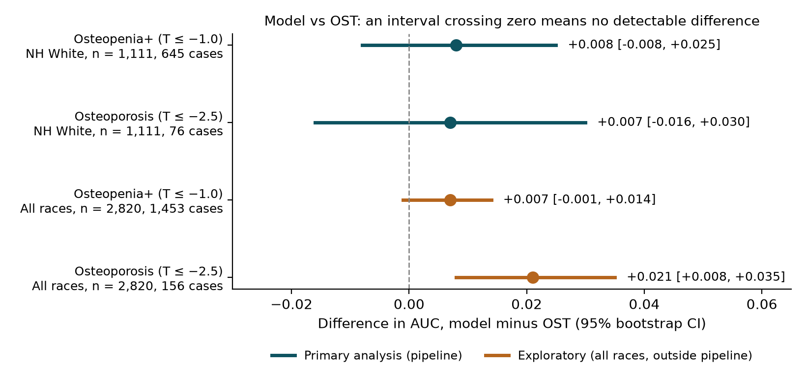
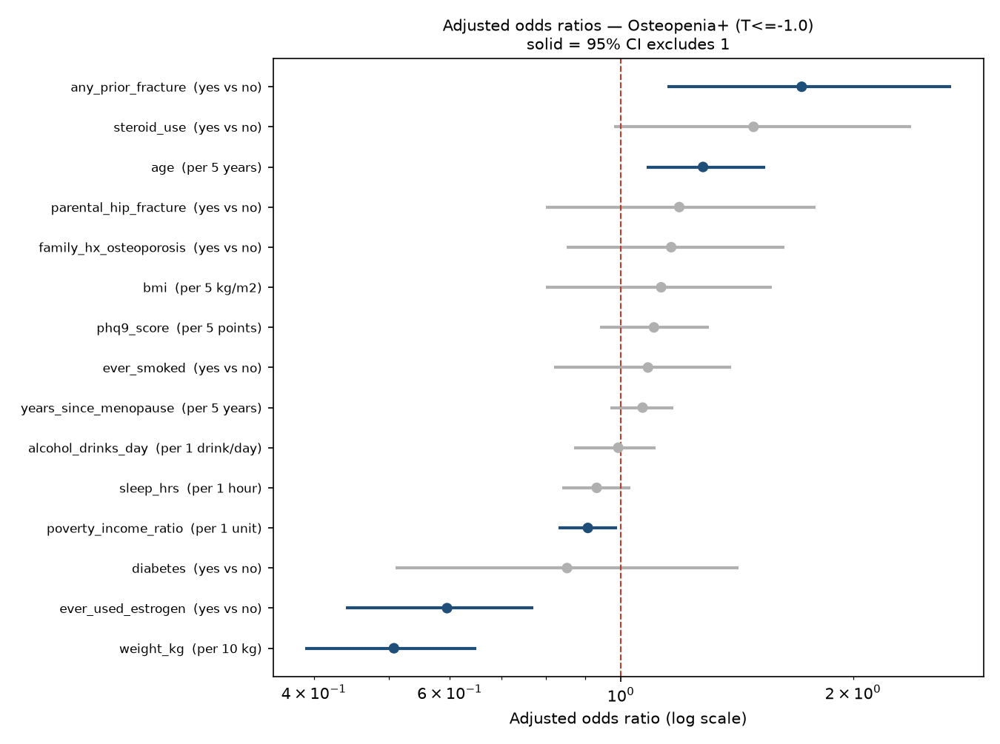
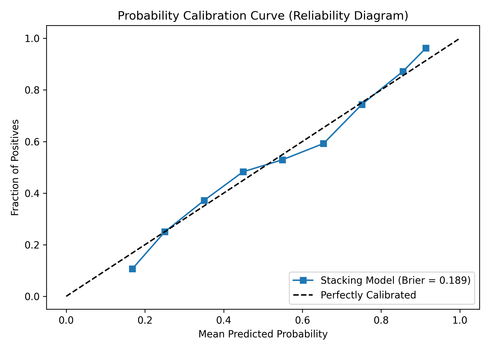

# Can a Questionnaire-Based Machine-Learning Model Improve on the Osteoporosis Self-Assessment Tool? A Leakage-Audited Analysis of Postmenopausal Women Aged 50–65 in NHANES

**Draft for specialist review** · Prepared 25 October 2026 · Author: [student name] · Clinical adviser: [specialist name]

*Draft for specialist review, not for wider circulation. All figures in Sections 3.1–3.6 come from
the current committed run of the analysis pipeline (OsteoporosisML.py). Section 3.7 reports
exploratory analyses that are not yet part of the pipeline.*

---

## Abstract

**Background.** The USPSTF (2025) recommends that postmenopausal women under 65 with risk factors be
assessed with a clinical risk tool before DXA. The Osteoporosis Self-Assessment Tool (OST),
0.2 × (weight in kg − age in years), is one of the recommended tools, but its discrimination in this
age group is only moderate. We asked whether a machine-learning model using information available at a
primary-care visit, without imaging or laboratory tests, identifies low bone density better than OST.

**Methods.** Cross-sectional analysis of five NHANES cycles (2005–2006, 2007–2008, 2009–2010,
2013–2014, 2017–March 2020). Participants were non-Hispanic White, postmenopausal women aged 50–65 with
hip DXA (n = 1,111). Outcomes were the lower of femoral-neck and total-hip T-score ≤ −1.0
(osteopenia or worse) and ≤ −2.5 (osteoporosis). We used 15 patient-reportable or nurse-measurable
predictors from a specialist-approved list. Eight algorithms were evaluated by nested 5-fold
cross-validation. The model-minus-OST difference in AUC was estimated with a paired bootstrap 95% CI.
Seven additional predictor sets were pre-specified and tested. A duplicate-respondent audit was built
in after we found overlapping NHANES releases.

**Results.** 645 women (58.1%) had T ≤ −1.0 and 76 (6.8%) had T ≤ −2.5.
- **Osteopenia+:** nested AUC **0.747** vs OST **0.739**, difference +0.008 (95% CI −0.008 to +0.025).
- **Osteoporosis:** nested AUC **0.786** vs OST **0.780**, difference +0.007 (−0.016 to +0.030).
- Neither difference was statistically detectable.
- Body weight carried most of the signal (adjusted OR 0.51 per 10 kg). Removing weight and BMI reduced
  the AUC from 0.755 to 0.603, and age plus weight alone gave 0.739.
- None of the seven pre-specified additions improved discrimination: dietary or supplement vitamin D
  and calcium, serum 25(OH)D, rheumatoid arthritis, depression, physical activity, and sleep.
- In an exploratory all-race cohort (n = 2,820), the model exceeded OST for osteoporosis by +0.021
  (+0.008 to +0.035), but not for osteopenia+.

**Conclusions.** In postmenopausal women aged 50–65, a machine-learning model built on
questionnaire and examination data did not detectably outperform OST. Almost all of the predictive
information is in body weight and age, which OST already uses. OST appears to be close to the
practical limit of non-imaging, non-laboratory screening in this group. A small gain for osteoporosis in
a larger, multi-ethnic cohort deserves confirmation.

---

## 1. Introduction

Osteoporosis is under-diagnosed in women younger than 65, the age at which routine DXA screening
begins. For younger postmenopausal women with risk factors, the 2025 USPSTF recommendation advises a
clinical risk assessment tool first, citing OST and ORAI for identifying osteoporosis. These tools
discriminate only moderately in this age group. In the Women's Health Initiative Bone Density
Substudy of women aged 50–64, OST's AUC for osteoporosis at any site was 0.654 (Zheng et al., 2025).

Machine-learning (ML) studies often report much higher AUCs, some above 0.90. Many of those studies,
however:
- include men or a wide age range
- use laboratory or imaging inputs
- define the outcome by self-reported diagnosis
- validate on a single random split without comparing against an established simple tool

When ML is compared with OST under careful validation, the gains reported are usually small
(+0.02 to +0.05). A systematic review found no AUC advantage of ML over logistic regression among
studies at low risk of bias (Christodoulou et al., 2019).

**Objective.** To test whether an ML model using only information available at a primary-care visit
(history, lifestyle and simple measurements, with no blood tests or imaging) identifies low bone
density in postmenopausal women aged 50–65 better than OST, under a validation design that prevents
optimistic bias.

---

## 2. Methods

### 2.1 Data source
NHANES is a nationally representative US survey that combines interviews, physical examination and,
in selected cycles, hip DXA. Five cycles with femoral-neck DXA were used: 2005–2006, 2007–2008,
2009–2010, 2013–2014 and 2017–March 2020 (pre-pandemic release).

The 2017–2018 cycle was **deliberately excluded**. Because fieldwork stopped in March 2020, NCHS pooled
the complete 2017–2018 sample into the 2017–March 2020 files under new respondent ID numbers. Loading
both put 176 women into the dataset twice under different IDs (Section 2.7).

### 2.2 Study population

| Step | Remaining |
|---|---|
| NHANES respondents, five cycles | 56,769 |
| Female | 28,644 |
| Non-Hispanic White | 10,672 |
| Aged 50–65 | 1,639 |
| Femoral-neck DXA result available | 1,308 |
| Excluded: reported a menstrual period in the past 12 months | −156 |
| Excluded: menopausal status could not be determined | −41 |
| **Analysis cohort: postmenopausal women** | **1,111** |

**Postmenopausal** was defined as no menstrual period in the past 12 months (RHQ031), as agreed with
the specialist. The 41 women of unknown status are a different group from the 156 still menstruating:
their mean T-score (−1.155) and median age (58) were close to the retained cohort (−1.140, 59). They
were excluded because their status was unknown, not because they were premenopausal. No
menopause-type variable (natural or surgical) was used, per the specialist's ruling.

Women by cycle: 173, 228, 227, 219 and 264.

### 2.3 Outcomes
T-scores were calculated against the NHANES III young non-Hispanic White female reference (Looker et
al., 1998):
- femoral neck: mean 0.858 g/cm², SD 0.120
- total hip: mean 0.942 g/cm², SD 0.122

Following the WHO/ISCD convention, **the lower of the two sites** defined each woman's T-score. This was
rounded to three decimals before applying cut-points. Two binary outcomes were analysed:
- **Osteopenia or worse ("osteopenia+"):** T ≤ −1.0. Primary outcome.
- **Osteoporosis:** T ≤ −2.5. Secondary outcome.

The specialist had suggested the continuous T-score as the primary outcome. We kept a binary primary
outcome because the clinical decision is whether to refer for DXA, and because reporting conventions
for screening tools expect a binary outcome. The continuous T-score was still used: three of the eight
models predict the T-score directly (2.5). Single-site outcomes (femoral neck only, total hip only)
were pre-specified sensitivity analyses.

### 2.4 Predictors
Predictors were limited to information obtainable at a primary-care visit without imaging or
laboratory tests, and followed the specialist's written variable list. DXA-derived values were
blocked from entering any model through a fixed allow-list plus an automatic check.

| Domain | Predictor | Coding |
|---|---|---|
| Demographic | Age | Years |
| | Poverty income ratio | Continuous (household income relative to the poverty line) |
| Body size | Weight | kg (measured) |
| | BMI | kg/m² (measured) |
| Menopause / hormones | Years since menopause | Years |
| | Ever used estrogen | Yes / no |
| Medical history | Diabetes | Yes / no |
| | Any prior fracture | Yes / no |
| | Oral steroid use | Yes / no |
| Family history | Parental hip fracture | Yes / no |
| | Family history of osteoporosis | Yes / no |
| Lifestyle | Ever smoked | Yes / no (≥ 100 cigarettes) |
| | Alcohol | None / < 3 / ≥ 3 drinks per day (reference: < 3), as specified |
| Mental health / sleep | PHQ-9 depression score | 0–27 |
| | Sleep | Hours per night |

That's 15 predictors and 16 model columns (alcohol uses two indicator columns).

NHANES "refused" and "don't know" codes were set to missing for each variable separately. Remaining
missing values were filled with the median, learned **within each training fold only**. The largest
missing share was 13.6%, for alcohol.

### 2.5 Models
Eight algorithms were fitted:
- **Five classifiers on the binary outcome:** logistic regression (L2), elastic-net logistic
  regression, random forest, LightGBM and XGBoost. The boosted models were strongly regularised
  (depth 2).
- **Three regressors on the continuous T-score:** ridge regression, random forest and LightGBM. Their
  predicted T-score was used as the risk score.

Imputation and scaling were fitted inside each training fold. Class imbalance was handled with
balanced class weights.

### 2.6 Validation and statistical analysis
- **Nested cross-validation.** Reporting the best of eight models on the same data that scores it
  overstates performance. In each of 5 outer folds, the best algorithm was chosen by an inner 3-fold
  cross-validation on the training portion only, then scored on the untouched outer fold. **The nested
  AUC is the primary estimate.** The ordinary leaderboard AUC is reported as an upper bound.
- **Comparators.** OST = 0.2 × (weight − age), with lower values meaning higher risk. Body weight alone
  served as a second comparator.
- **Primary comparison.** The difference in AUC between the nested model and OST in the same women,
  with a paired bootstrap 95% CI (1,000 resamples). A difference was called detectable only if the
  whole CI excluded zero.
- **Sample size.** Events per predictor were checked against a minimum of 10 (Riley et al., 2020)
  before the analysis.
- **Predictor effects.** Adjusted odds ratios from logistic regression with bootstrap 95% CIs;
  permutation importance; refitting without single variables (Holm-corrected) and without whole
  variable groups.
- **Calibration.** Reliability curve and Brier score for a sigmoid-calibrated random forest.
- **Clinical translation.** DXA referrals, cases found and cases missed at a range of cut-offs.
- **Pre-specified additions.** Seven predictor sets, each tested on the women with that variable
  available, against a base model refitted on the same women.
- **Reproducibility.** Fixed random seed (42); the whole analysis reproduces exactly.
- **Survey weights were not applied.** The cycle set is non-contiguous, so no valid pooled weight
  exists. Results describe this sample, not the US population.

### 2.7 Data-integrity audit
An earlier version of the analysis included both the 2017–2018 cycle and the 2017–March 2020 release.
Because NHANES re-numbered respondents when it pooled these, **176 women appeared twice under different
ID numbers**. An ID-based duplicate check can't detect this. Cross-validation splits by row, not by
person, so one copy of a woman could be in the training data while the other was being tested. That
inflated every AUC.

The overlapping cycle was removed. The pipeline now checks a physical fingerprint (femoral-neck BMD,
total-hip BMD, weight, height and age) and stops if any two records match. All results from before this
correction are withdrawn (Section 3.6).

---

## 3. Results

### 3.1 Cohort characteristics

**Table 1. Characteristics by bone status** (mean (SD) or %)

| Characteristic | Normal, T > −1.0 (n = 466) | Low bone mass, −2.5 < T ≤ −1.0 (n = 569) | Osteoporosis, T ≤ −2.5 (n = 76) | All (n = 1,111) |
|---|---|---|---|---|
| Age, years | 57.8 (4.5) | 58.5 (4.4) | 59.5 (3.9) | 58.3 (4.4) |
| Weight, kg | 84.6 (17.1) | 71.8 (14.9) | 62.5 (14.4) | 76.5 (17.4) |
| BMI, kg/m² | 31.5 (6.3) | 27.3 (5.6) | 24.4 (5.4) | 28.9 (6.4) |
| Years since menopause | 11.5 (8.9) | 12.4 (8.4) | 15.6 (9.7) | 12.2 (8.7) |
| Ever used estrogen | 47.7% | 41.9% | 32.9% | 43.7% |
| Diabetes | 13.1% | 8.1% | 6.6% | 10.1% |
| Ever smoked | 49.8% | 53.1% | 71.1% | 52.9% |
| Any prior fracture | 12.7% | 17.0% | 27.6% | 15.9% |
| Oral steroid use | 7.3% | 9.5% | 10.5% | 8.7% |
| Poverty income ratio | 3.4 (1.7) | 3.2 (1.7) | 2.2 (1.6) | 3.2 (1.7) |
| Parental hip fracture | 13.3% | 17.3% | 18.6% | 15.7% |
| Family history of osteoporosis | 26.7% | 31.6% | 36.1% | 29.8% |
| PHQ-9 score | 3.8 (4.6) | 3.8 (4.5) | 4.8 (5.9) | 3.8 (4.7) |
| Sleep, hours | 7.2 (1.3) | 7.1 (1.4) | 6.8 (1.8) | 7.1 (1.4) |

Mean age was 58.3 years. Women with osteoporosis were on average **22 kg lighter** than women with
normal BMD. 58% of the osteoporosis group had a BMI of 18.5–24.9, against 13% of the normal group.
They also smoked more and had more prior fractures. Diabetes was less common at lower BMD, in line with
the known higher BMD in type 2 diabetes.

### 3.2 Discrimination and comparison with OST

**Table 2. Model performance by outcome**

| | Osteopenia+ (T ≤ −1.0) | Osteoporosis (T ≤ −2.5) |
|---|---|---|
| Cases / total | 645 / 1,111 (58.1%) | 76 / 1,111 (6.8%) |
| Events per predictor | 29.1 (adequate) | 4.75 (**below the minimum of 10**) |
| Algorithm range, 5-fold CV | 0.736–0.752 | 0.733–0.793 |
| Best single algorithm | Logistic regression, 0.752 | Elastic-net logistic regression, 0.793 |
| **Nested CV AUC (primary)** | **0.747** | **0.786** |
| OST AUC | 0.739 | 0.780 |
| Weight-alone AUC | 0.737 | 0.766 |
| **Model − OST (95% CI)** | **+0.008 (−0.008 to +0.025)** | **+0.007 (−0.016 to +0.030)** |
| Model − weight alone (95% CI) | +0.010 (−0.007 to +0.027) | +0.021 (−0.005 to +0.048) |
| Verdict | No detectable difference | No detectable difference (underpowered) |

**Findings:**
- For **osteopenia+**, the model and OST were statistically indistinguishable. The difference was less
  than 0.01, and its CI comfortably includes zero.
- For **osteoporosis**, discrimination was somewhat higher for both methods. The difference was again
  not detectable. With only 76 cases, this outcome is underpowered, and the result should be read as
  inconclusive rather than as evidence that the two are equivalent.
- **Simple logistic regression matched or beat the more complex algorithms.** The choice of algorithm
  made little difference.

### 3.3 Determinants of prediction

**Table 3. Adjusted odds ratios, osteopenia+** (logistic regression with all 15 predictors)

| Predictor | Unit | OR (95% CI) |
|---|---|---|
| **Weight** | per 10 kg | **0.51 (0.39–0.65)** |
| **Age** | per 5 years | **1.27 (1.07–1.52)** |
| **Any prior fracture** | yes vs no | **1.76 (1.20–2.74)** |
| **Ever used estrogen** | yes vs no | **0.59 (0.43–0.76)** |
| **Poverty income ratio** | per 1 unit | **0.90 (0.82–0.98)** |
| Oral steroid use | yes vs no | 1.49 (0.98–2.39) |
| Parental hip fracture | yes vs no | 1.18 (0.80–1.77) |
| Family history of osteoporosis | yes vs no | 1.16 (0.85–1.62) |
| BMI | per 5 kg/m² | 1.12 (0.80–1.57)* |
| Years since menopause | per 5 years | 1.07 (0.97–1.17) |
| Ever smoked | yes vs no | 1.08 (0.82–1.39) |
| PHQ-9 | per 5 points | 1.11 (0.94–1.31) |
| Sleep | per hour | 0.93 (0.84–1.03) |
| Diabetes | yes vs no | 0.86 (0.52–1.46) |
| Alcohol ≥ 3/day | vs < 3/day | 0.71 (0.43–1.07) |
| No alcohol | vs < 3/day | 0.90 (0.59–1.31) |

Bold: 95% CI excludes 1. *BMI has no independent effect once weight is in the model, because the two
carry the same information.

**Table 4. Removing groups of predictors** (osteopenia+; full model AUC 0.755 in this analysis)

| Model | Predictors | AUC | Loss vs full model (95% CI) |
|---|---|---|---|
| Without body size (weight + BMI) | 13 | **0.603** | **0.151 (0.115 to 0.187)** |
| Without menopause/hormone variables | 13 | 0.749 | 0.006 (−0.000 to 0.013) |
| Without lifestyle variables | 13 | 0.756 | −0.001 (−0.004 to 0.003) |
| Without history/family variables | 11 | 0.751 | 0.004 (−0.003 to 0.011) |
| **Age + weight only (OST's inputs)** | **2** | **0.739** | 0.016 (−0.000 to 0.031) |
| Age + BMI only | 2 | 0.718 | 0.037 (0.016 to 0.057) |

**Findings:**
- **Body size is nearly the whole model.** Each additional 10 kg halved the odds of osteopenia+.
- Without weight and BMI, discrimination fell almost to chance (0.603).
- Removing any other group entirely had no measurable effect.
- **Age and weight alone reproduced OST's AUC exactly (0.739).** The remaining 13 predictors added
  +0.016, and that CI touches zero.
- In the single-variable analysis after Holm correction, only weight was individually significant.
- Prior fracture, estrogen use, age and income had clinically expected, statistically significant
  adjusted associations, but each contributed little additional discrimination.

### 3.4 Calibration and clinical translation
The calibrated model's predicted probabilities tracked observed rates closely. The Brier score was
0.200, against about 0.24 for a constant prediction.

**Table 5. DXA referral at different risk cut-offs** (osteopenia+, calibrated model, 1,111 women, 645 cases)

| Refer if predicted risk ≥ | DXAs ordered | Cases found (sensitivity) | Cases missed | DXAs avoided vs scanning all |
|---|---|---|---|---|
| 50% | 692 | 482 (74.7%) | 163 | 419 (38%) |
| 40% | 895 | 579 (89.8%) | 66 | 216 (19%) |
| 35% | 965 | 603 (93.5%) | 42 | 146 (13%) |
| 30% | 1,030 | 631 (97.8%) | 14 | 81 (7%) |
| Scan all | 1,111 | 645 (100%) | 0 | 0 |

A 40% cut-off would detect about 90% of women with osteopenia or worse while avoiding about one in
five scans. Because the model and OST discriminate equally, **OST at an equivalent threshold should give
comparable referral efficiency at no cost.**

### 3.5 Pre-specified additional predictors and sensitivity analyses

**Table 6. Pre-specified additions** (osteopenia+; each compared with a base model refitted on the same women)

| Addition | n | Change in AUC (95% CI) | Result |
|---|---|---|---|
| Dietary + supplement vitamin D and calcium | 930 | −0.002 (−0.006 to +0.001) | No gain |
| Serum 25(OH)D | 974 | −0.001 (−0.008 to +0.005) | No gain |
| Rheumatoid arthritis | 988 | 0.000 (−0.001 to +0.001) | No gain |
| Depression, PHQ-9 ≥ 10 | 1,110 | −0.001 (−0.002 to +0.000) | No gain |
| Physical activity (MET-min/week + sitting time) | 932 | +0.004 (−0.002 to +0.009) | No gain |
| Moderate + vigorous minutes + sitting | 932 | +0.003 (−0.002 to +0.009) | No gain |
| Sleep in five categories | 1,107 | −0.001 (−0.007 to +0.006) | No gain |

**Sensitivity analyses:**
- Reclassifying borderline diabetes as diabetes, or removing diabetes altogether, left the AUC
  unchanged (0.755).
- Single-site outcomes: femoral neck only, 618 cases, AUC 0.747; total hip only, 424 cases, AUC 0.776.
- Repeating the analysis with 3-fold instead of 5-fold cross-validation didn't change any conclusion
  (osteopenia+ 0.752, Δ vs OST +0.014 (−0.003 to +0.029); osteoporosis 0.790, Δ +0.011 (−0.013 to
  +0.034)).

### 3.6 Effect of the duplicate-respondent correction

**Table 7. AUC before and after removing duplicate respondents** (osteopenia+)

| Analysis | n | Best AUC | OST AUC | Difference (95% CI) |
|---|---|---|---|---|
| With duplicates, all women with DXA | 1,484 | 0.836 | 0.747 | +0.089 (+0.070 to +0.107) |
| With duplicates, postmenopausal | 1,272 | 0.831 | 0.733 | +0.098 (+0.077 to +0.120) |
| Duplicates removed, all women with DXA | 1,308 | 0.763 | 0.753 | +0.010 (−0.005 to +0.024) |
| **Duplicates removed, postmenopausal (final)** | **1,111** | **0.755** | **0.739** | **+0.016 (−0.001 to +0.030)** |

Removing the 176 duplicated women lowered the AUC by 0.073, and the apparent advantage over OST
disappeared. Restricting to postmenopausal women cost almost nothing (−0.005). The earlier finding that
"ML beats OST" was caused entirely by duplicate leakage. All pre-correction figures (AUC 0.810, 0.806,
0.833) are withdrawn.

### 3.7 Exploratory analyses (outside the main pipeline)
These were run with separate scripts that use the pipeline's code unchanged. They have **not yet** been
built into the pipeline with their own cohort checks, and are reported as hypothesis-generating.

**(a) All races.** Removing the race restriction, with all other criteria unchanged, gave 2,820
postmenopausal women aged 50–65: 1,453 with T ≤ −1.0 and 156 with T ≤ −2.5. The race mix was 1,111
non-Hispanic White, 660 non-Hispanic Black, 441 Mexican American, 315 other Hispanic and 293 other or
multiracial.

| Outcome | Model (nested) | OST | Difference (95% CI) |
|---|---|---|---|
| Osteopenia+ | 0.757 | 0.751 | +0.007 (−0.001 to +0.014) |
| Osteoporosis | 0.822 | 0.800 | **+0.021 (+0.008 to +0.035)** |

OST AUC for osteopenia+ by group: White 0.739, Black 0.768, Mexican American 0.692, other Hispanic 0.744,
other/multiracial 0.738. Osteoporosis AUCs by group rest on 16–29 cases each and aren't interpretable.
All T-scores used the White female reference, following the ISCD convention.

**(b) Medications and weight history.** These were pre-specified before running:
- **Medications:** 8 classes from the prescription file (proton-pump inhibitors, antidepressants,
  thiazides, loop diuretics, thyroid hormone, anticonvulsants, aromatase inhibitors,
  thiazolidinediones).
- **Weight history:** change since age 25, distance below lifetime maximum, change in the past year.
- **Height-loss proxy:** recalled minus measured height.

Each was tested in three cohorts (White; all races; all races excluding women already on osteoporosis
drugs) for both outcomes, 24 tests in all. Osteoporosis medications were never used as predictors. Only
one test reached significance: medications, osteoporosis, all races, +0.008 (+0.000 to +0.016). It did
not survive excluding the 119 women already on osteoporosis treatment (+0.006, −0.002 to +0.016).

---

## 4. Discussion

### 4.1 Principal findings
In postmenopausal women aged 50–65, a machine-learning model using 15 primary-care predictors
identified low bone density **no better than OST**. The reason is clear from the analysis. Body
weight carries most of the predictive information and age adds a modest amount; those are exactly
OST's two inputs. Other recognised risk factors are associated with low BMD in the expected direction:
prior fracture, estrogen use, steroid use, smoking and family history. Once weight and age are known,
though, they add little to *discrimination*. No algorithm, and none of seven pre-specified additional
variable sets, changed this.

### 4.2 Comparison with the literature
- **OST performance here (0.739 for osteopenia+, 0.780 for osteoporosis)** lies within the published
  range in younger postmenopausal women. Published values include 0.72 in Manitoba women aged 50–64
  (Leslie et al., 2013), 0.73 for femoral-neck osteoporosis in the WHI (Crandall et al., 2014), and
  0.654 for any-site osteoporosis rising to about 0.82 for the femoral neck in the WHI bone density
  substudy (Zheng et al., 2025).
- **Similar ML results have been reported elsewhere:**
  - An independent NHANES analysis of postmenopausal women reported an AUC of 0.764 for a Bayesian
    network and 0.752 for logistic regression (Wu et al., 2023).
  - In Korean postmenopausal women, SVM exceeded OST by +0.021, and logistic regression matched OST
    (Yoo et al., 2013).
  - A systematic review of postmenopausal osteoporosis models found a pooled AUC of 0.74 for ML and
    0.75 for regression (BMC Musculoskelet Disord, 2026).
- **Studies reporting much larger gains** typically include men or older women, laboratory or imaging
  inputs, self-reported diagnosis as the outcome, or a comparison tool that performed unusually
  poorly. For example, an NHANES model using weight, age and height beat OST by +0.047 in adults of
  both sexes aged 50 and over (Zhang et al., 2025).
- **The duplicate problem.** We found no published NHANES study that reports checking for respondents
  duplicated across the overlapping 2017–2018 and 2017–March 2020 releases. In our data that leak
  created an apparent +0.07 to +0.09 advantage over OST.

### 4.3 Clinical implications
- For primary-care identification of low bone density in women aged 50–65, the data support **using
  OST**. It is free, needs no computer, and performs as well as a 15-variable ML model.
- Expanding the questionnaire with lifestyle, nutritional, mood, sleep or activity items is unlikely
  to improve selection for DXA.
- Further gains will probably need information that isn't body size, such as imaging, laboratory or
  fracture-history detail. That moves beyond the no-test, primary-care setting this study was
  designed for.
- The exploratory all-race result (+0.021 for osteoporosis) suggests ML may add a little for
  treatment-level disease when there are enough cases. It needs confirmation before it has any
  clinical relevance.

### 4.4 Strengths
- OST was set as the comparator in advance, and the difference was tested with paired confidence
  intervals.
- Nested cross-validation separates model selection from testing.
- Additional predictor sets were pre-specified, so null findings are interpretable.
- A built-in duplicate-respondent audit.
- The predictor list was developed with an osteoporosis specialist.
- Every step is reproducible.

### 4.5 Limitations
1. **Osteoporosis is underpowered** in the main cohort: 76 cases, 4.75 events per predictor.
2. **No external validation.** All estimates come from cross-validation within NHANES. Holding out one
   survey cycle as a test set is planned.
3. **Survey weights not applied.** The results describe this sample, not the US population.
4. **Cross-sectional design.** The outcome is current BMD, not future fracture.
5. **T-scores use a White female reference for all women,** which affects the comparisons between
   race groups in Section 3.7.
6. **Restricted population:** non-Hispanic White women in the main analysis; women aged 50–65 only;
   femoral neck and total hip only, with no lumbar spine.
7. **Self-reported predictors** (fracture, steroid use, menopause timing) may be misclassified.
   Falls history was unavailable.
8. **Exploratory analyses** (Section 3.7) used scripts outside the main pipeline and need to be
   formally integrated.

---

## 5. Conclusions
In postmenopausal women aged 50–65, a machine-learning model built from routinely available
questionnaire and examination data did not detectably improve on the two-variable OST for identifying
osteopenia or osteoporosis. Weight and age carry nearly all of the available signal, so OST appears
to be close to the practical ceiling for non-imaging, non-laboratory screening in this group.
Clinicians can continue to rely on OST to guide DXA referral in younger postmenopausal women. A
possible small advantage for osteoporosis in a larger, multi-ethnic cohort deserves external
confirmation.

---

## 6. Questions for the specialist
1. **Clinically meaningful difference.** What AUC difference, or how many fewer DXAs per 1,000 women,
   would justify using a model instead of OST? This would let us test formal equivalence.
2. **Primary outcome.** For this age group, is identifying osteopenia+ or osteoporosis the more
   important target?
3. **Race.** Should race be a predictor, used only to report results by group, or left out? Should we
   run a sensitivity analysis with race-specific reference values?
4. **Treated women.** Should women already on osteoporosis medication be excluded from the main
   analysis?
5. **Comparators.** Should we also compare against FRAX (without BMD), ORAI, SCORE and OSIRIS?
6. **Missing predictors.** Which patient-reportable risk factors do you ask about in clinic that we
   haven't included (for example measured height loss, kyphosis, falls, early menopause)?
7. **External validation.** Is there a clinical dataset that could be used for external validation,
   with appropriate approvals?

---

## References
1. US Preventive Services Task Force. Screening for osteoporosis to prevent fractures:
   recommendation statement. 2025.
2. Zheng HW, Crandall CJ, et al. Identifying younger postmenopausal women with osteoporosis using
   USPSTF-recommended osteoporosis risk assessment tools. *JAMA Netw Open*. 2025.
3. Crandall CJ, et al. Osteoporosis screening in postmenopausal women 50 to 64 years old: comparison of
   USPSTF strategy and two traditional strategies in the Women's Health Initiative. *J Bone Miner
   Res*. 2014.
4. Leslie WD, et al. Selection of women aged 50–64 yr for bone density measurement. *Osteoporos Int*.
   2013.
5. Geusens P, et al. Performance of risk indices for identifying low bone density in postmenopausal
   women. *Mayo Clin Proc*. 2002. (OST)
6. Looker AC, et al. Updated data on proximal femur bone mineral levels of US adults. *Osteoporos Int*.
   1998.
7. Christodoulou E, et al. A systematic review shows no performance benefit of machine learning over
   logistic regression for clinical prediction models. *J Clin Epidemiol*. 2019.
8. Riley RD, et al. Calculating the sample size required for developing a clinical prediction model.
   *BMJ*. 2020.
9. Collins GS, et al. TRIPOD+AI statement: updated guidance for reporting clinical prediction models
   that use regression or machine learning methods. *BMJ*. 2024.
10. Wu et al. Construction of predictive model for osteoporosis related factors among postmenopausal
    women on the basis of logistic regression and Bayesian network. *Prev Med Rep*. 2023.
11. Yoo TK, et al. Osteoporosis risk prediction for bone mineral density assessment of postmenopausal
    women using machine learning. *Yonsei Med J*. 2013.
12. Zhang et al. A machine-learning-based osteoporosis screening tool integrating the SHAP method:
    model development and validation study. *Arch Osteoporos*. 2025.
13. Risk prediction models / clinical prediction models for postmenopausal osteoporosis: systematic
    review and meta-analysis. *BMC Musculoskelet Disord*. 2026.
14. Nayak S, et al. Systematic review and meta-analysis of the performance of clinical risk
    assessment instruments for screening for osteoporosis or low bone density. *Osteoporos Int*. 2015.

*Reference details (volume, pages) should be verified against the original publications before
external circulation.*
